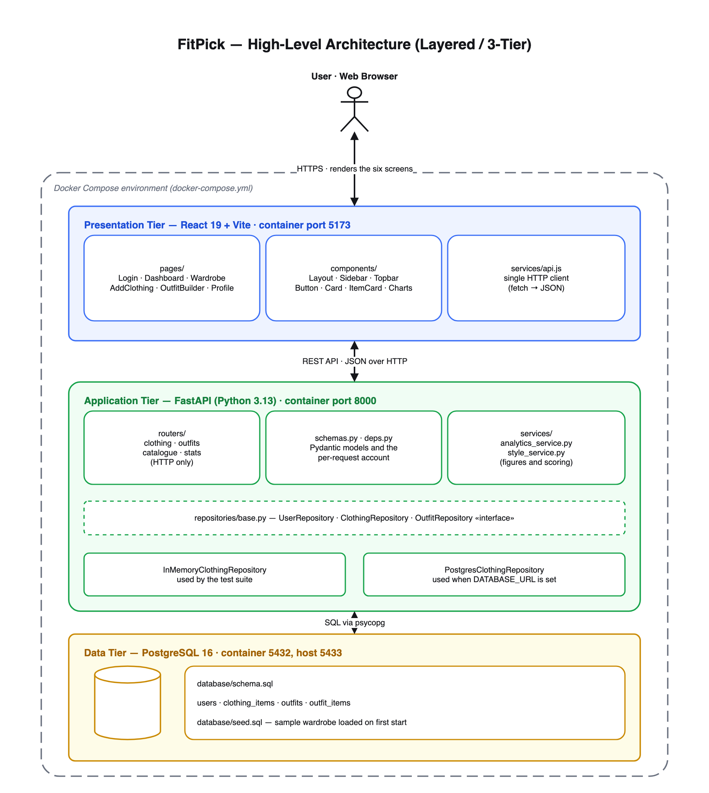

# FitPick – Digital Wardrobe & Outfit Planner

FitPick is a web application that helps people organise the clothes they already own and plan outfits from them. Users add clothing items to a digital wardrobe, browse and filter them, combine items into outfits, save their favourites and track simple wardrobe statistics.

## Project Overview

| | |
|---|---|
| **Type** | Web application (single-page React frontend + REST API) |
| **Frontend** | React 19 + Vite |
| **Backend** | FastAPI (Python 3.12) |
| **Database** | PostgreSQL 16 |
| **Environment** | Docker Compose |
| **Repository** | https://github.com/nithi0307/fitpick |

## Problem it Solves

Most people own far more clothes than they actually wear, and deciding what to wear each morning is slow and repetitive. Clothes get forgotten at the back of the wardrobe, similar items get bought twice, and outfit ideas are never written down. FitPick gives users a single place to see everything they own, search it quickly, and save outfit combinations so getting dressed becomes a two-minute decision instead of a daily struggle.

## Target Users / Personas

**Persona 1 – College Student (Priya, 20)**
Owns a moderate wardrobe on a tight budget. Wants to avoid repeating the same outfits and buying duplicates. Needs a quick, mobile-friendly way to see what she already has.

**Persona 2 – Working Professional (Arjun, 29)**
Needs formal and smart-casual outfits ready for the week. Values speed: wants to open the app, pick a saved outfit and go. Cares about categories such as "Formal" and "Casual".

**Persona 3 – Fashion Enthusiast (Meera, 24)**
Owns a large wardrobe and enjoys experimenting. Wants to build and save many outfit combinations, mark favourites, and see statistics about her wardrobe.

## Vision Statement

To make wardrobe management simple and organised, so that every user can see what they own, plan outfits easily and get more value from the clothes they already have.

## Key Features / Goals

- User registration, login and logout
- Add, edit, delete and view clothing items
- Search, filter and sort the wardrobe
- Create, edit, delete and favourite outfits
- Dashboard with recently added items and wardrobe statistics
- Profile management and password change

The full feature list is tracked as 25 GitHub issues, prioritised with MoSCoW on the **FitPick Development Board** (15 Must Have, 10 Should Have).

## Success Metrics

- A new user can add their first clothing item within 2 minutes of signing up
- A user can build and save an outfit in under 1 minute
- Wardrobe search returns results in under 1 second for a 500-item wardrobe
- 80 % of test users rate the interface "easy to use" or better

## Assumptions

- Users are willing to spend some initial time entering their wardrobe
- Users access the app mainly from a laptop or phone browser
- Clothing images are optional; text details alone are enough to be useful

## Constraints

- Academic project with a fixed timeline and a single developer
- No AI-based recommendations in the initial version
- Must run locally with Docker Compose without paid cloud services

## Folder Structure

```
fitpick/
├── frontend/                 # React + Vite single-page app
│   └── src/
│       ├── pages/            # One component per screen (Login, Dashboard, ...)
│       ├── components/       # Reusable UI (Layout, Sidebar, Navbar, Button, Card)
│       ├── services/api.js   # The only module that talks to the backend
│       └── styles/global.css # Design tokens and shared styles
├── backend/                  # FastAPI application
│   ├── main.py               # App factory: CORS + router registration
│   ├── routers/              # HTTP endpoints (clothing.py, outfits.py)
│   ├── schemas.py            # Pydantic models = the API contract
│   └── repositories/         # Data access, hidden behind one class per entity
├── database/
│   ├── schema.sql            # PostgreSQL tables
│   └── seed.sql              # Sample data for development
├── docs/
│   └── design/               # Software design deliverables (see below)
├── docker-compose.yml
└── README.md
```

## Technology Stack

| Layer | Technology | Why |
|---|---|---|
| Frontend | React 19, Vite, React Router | Component model maps directly to the Figma screens; Vite gives instant reloads |
| Backend | FastAPI, Pydantic | Small, typed REST API with automatic validation and docs |
| Database | PostgreSQL 16 | Relational data (users → clothing items → outfits) with foreign keys |
| Containers | Docker Compose | One command starts all three services identically on any machine |
| Design | Figma, Draw.io | UI screens and architecture diagrams with editable sources |

## Software Design

Design deliverables for Digital Assignment 2 live in [`docs/design/`](docs/design/README.md).

### Architecture



- Editable source: [`docs/design/architecture/fitpick-architecture.drawio`](docs/design/architecture/fitpick-architecture.drawio)
- PNG export: [`docs/design/architecture/fitpick-architecture.png`](docs/design/architecture/fitpick-architecture.png)

### UI Design (Figma)

Screenshots of the six Figma screens are in [`docs/design/wireframes/`](docs/design/wireframes/):
[Login / Sign Up](docs/design/wireframes/01-login.png) ·
[Dashboard](docs/design/wireframes/02-dashboard.png) ·
[My Wardrobe](docs/design/wireframes/03-wardrobe.png) ·
[Add Clothing Item](docs/design/wireframes/04-add-clothing.png) ·
[Outfit Builder](docs/design/wireframes/05-outfit-builder.png) ·
[Profile & Analytics](docs/design/wireframes/06-profile.png)

### Main design choices

FitPick uses a layered three-tier architecture: a React frontend for presentation, a FastAPI backend for application logic and a PostgreSQL database for storage, all run together with Docker Compose. Each tier is split into small, single-purpose modules (pages/components/services on the frontend; routers/schemas/repositories on the backend) that communicate only through explicit interfaces – React props, one `api.js` client and Pydantic models – so a change in one module rarely forces a change in another. A shared Figma design system (royal blue on white/light grey, rounded cards, one sidebar) keeps every screen consistent and easy to learn.

The full write-up is in the [Software Design Document](docs/design/FitPick-Software-Design-Document.pdf).

## Branching Strategy

- `main` – stable, always runnable
- `feature-<name>` – one branch per feature/issue, merged into `main` through a pull request

## Quick Start

Requires Docker Desktop.

```bash
git clone https://github.com/nithi0307/fitpick.git
cd fitpick
docker compose up --build
```

| Service | URL |
|---|---|
| Frontend | http://localhost:5173 |
| Backend API | http://localhost:8000 (interactive docs at `/docs`) |
| PostgreSQL | `localhost:5433`, database `fitpick`, user/password `postgres` |

## Local Development Tools

Run the frontend and backend without Docker:

```bash
# frontend
cd frontend && npm install && npm run dev

# backend (separate terminal)
cd backend && python3 -m venv .venv && .venv/bin/pip install -r requirements.txt
.venv/bin/uvicorn main:app --reload
```

## Future Enhancements

- Persist data through a PostgreSQL-backed repository (the repository interface is already in place)
- Real authentication with hashed passwords and sessions
- Image upload for clothing items
- Outfit suggestions based on occasion and weather

## Authors

- Nithilan A (nithi0307)
